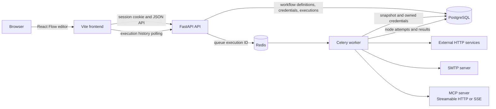

# FlowBridge architecture

FlowBridge separates workflow editing, API requests, and workflow execution. The API stores versioned graph
definitions and execution snapshots in PostgreSQL. It queues execution IDs in Redis; the Celery worker claims
each queued execution, runs its nodes in order, and saves node attempts and outputs for the run viewer.

## Execution flow

1. The editor saves a validated workflow graph. A version number prevents stale edits from overwriting newer saves.
2. A manual run or webhook request creates an execution with an immutable workflow snapshot and trigger payload.
3. The API queues the execution ID. The worker atomically changes its state from `queued` to `running` before
   executing it, so duplicate Celery deliveries cannot claim an already started execution.
4. The engine validates node parameters after resolving expressions, applies node retry and timeout settings,
   passes envelopes along active edges, and records one node-run entry per attempt.
5. The run viewer reads execution and node-run records from the API.

## Data and ownership

PostgreSQL holds users, workflows, executions, node runs, credentials, and MCP server tool caches. All
user-owned API reads are scoped to the signed-in user. Workflow snapshots keep in-flight runs stable if a user
edits the saved graph.

Credential JSON is encrypted with Fernet using a key derived from `FLOWBRIDGE_SECRET_KEY`. The API never returns
the plaintext value. The API and worker must use the same key so workers can read credentials. Losing or rotating
that key makes existing credentials unreadable; recreate them after rotation.

## Network nodes

The HTTP Request node accepts only HTTP and HTTPS URLs. It resolves the hostname, rejects the target if any DNS
answer is non-public, and connects to a selected validated IP while preserving the original HTTP Host and TLS
server name. It disables environment proxies and automatic redirects, so a redirect cannot bypass the IP check.
MCP servers use the official Python client over Streamable HTTP or SSE. MCP stdio is unsupported. Users can
configure bearer credentials for MCP servers; tool input schemas are cached and checked again at execution.

## Services and configuration

Docker Compose runs the Vite frontend, FastAPI API, Celery worker, Redis, and PostgreSQL. The API container
applies Alembic migrations before starting. `FLOWBRIDGE_SECRET_KEY`, GitHub OAuth settings, database settings,
and public URLs are configured in `.env`; see [self-hosting](../README.md#self-hosting).
